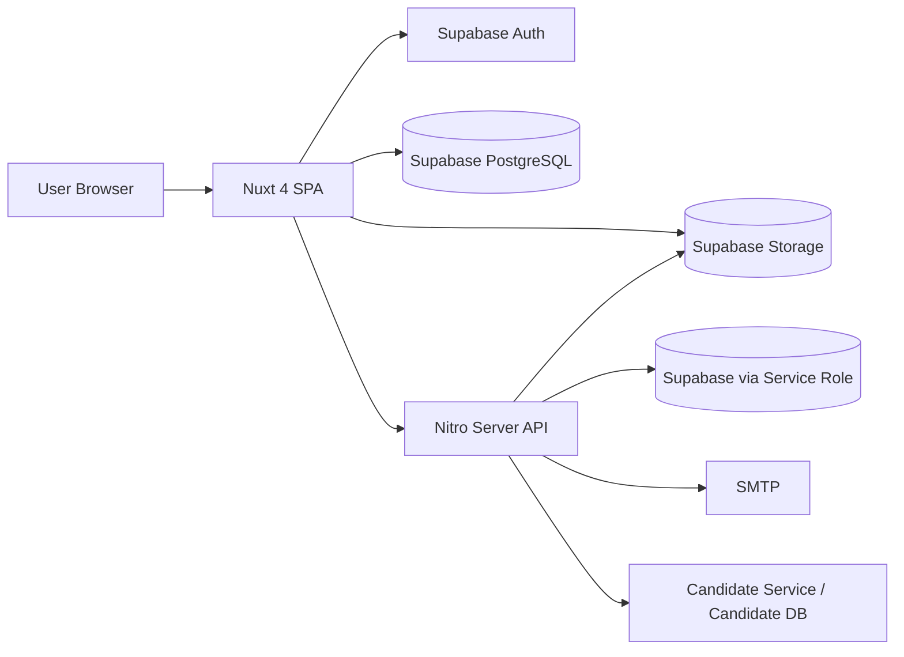
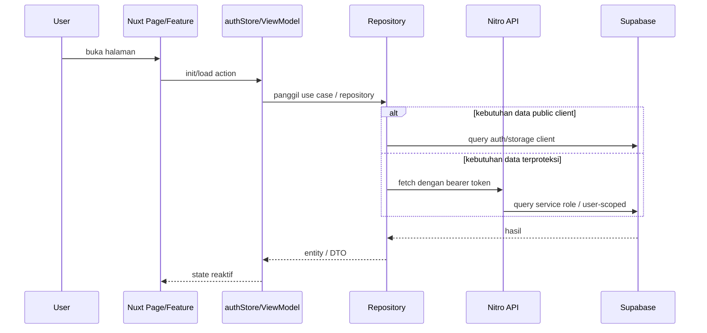
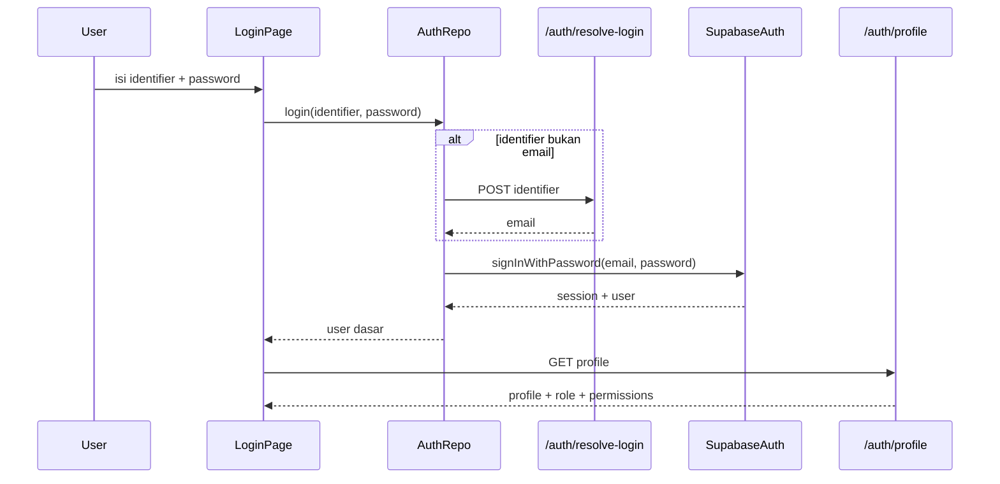
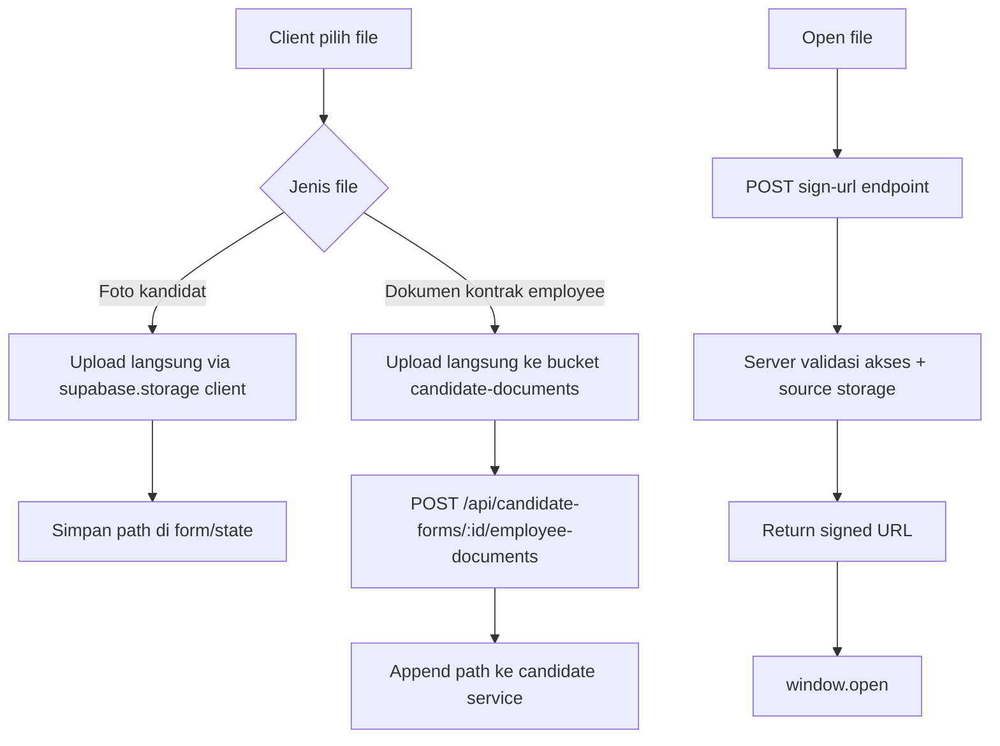
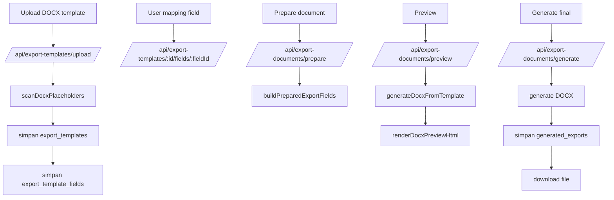

# 03. System Architecture

## Arsitektur Sistem Aktual

Project mengikuti arsitektur berlapis:

- `src/domain`: entity, contract repository, request object, util domain.
- `src/application`: use case yang mengorkestrasi repository.
- `src/infrastructure`: implementasi repository, client Supabase, adapter HTTP, helper security/runtime.
- `src/features`: page feature dan orchestration UI.
- `server/`: endpoint Nitro, service server, context auth, email, signed URL, export, dan service integration.

Frontend memanggil:

- Supabase client langsung untuk auth session dan beberapa upload file client-side.
- Endpoint Nitro untuk operasi yang butuh service role, permission check, rate limit, atau integrasi eksternal.

## Diagram Arsitektur

## Alur Komunikasi Nuxt.js dengan Supabase

1. Client membuat session/login melalui `supabase.auth.signInWithPassword`.
2. `authStore` mengambil access token session.
3. Untuk endpoint internal, `backendApi.ts` mengirim header `Authorization: Bearer <access_token>`.
4. Endpoint server memverifikasi token memakai `supabase.auth.getUser(accessToken)` dari service role client.
5. Server memuat role dan permission dari tabel `user_roles -> roles -> role_permissions -> permissions`.

## Client-Side Flow

## Server-Side Flow

Server-side aktif di folder `server/`:

- `server/api/*`: endpoint domain utama aplikasi.
- `server/routes/*`: endpoint Nitro non-`/api`, terutama admin/auth/approval/recruitment utility.
- `server/services/*`: logika bisnis server.
- `server/lib/context.js`: autentikasi request dan permission loading.

## Authentication Flow

## Database Query Flow

- Query list/detail biasa pada frontend dilakukan melalui repository implementation.
- Data yang sensitif atau perlu service role dilewatkan ke Nitro API.
- Candidate data tertentu dibaca dari candidate DB/service eksternal melalui `candidateDatabaseReadService.js` dan `candidateServiceClient.js`.

## Storage Upload / Download Flow

## Document Generation Flow

## Security Consideration

- `SUPABASE_SERVICE_ROLE_KEY` hanya dipakai di server.
- Middleware route client memeriksa permission per route.
- Endpoint server memvalidasi permission ulang melalui `requireAnyPermission`.
- Security header aktif di middleware server dalam mode report-only untuk CSP.
- File storage dibuka memakai signed URL satu jam.
- Rate limit aktif untuk resolve login, CSP report, dan send email.
- Tidak semua tabel export memiliki RLS yang ditemukan di repository; akses saat ini diamankan melalui endpoint server berpermission dan service role. Ini perlu perhatian tambahan.
