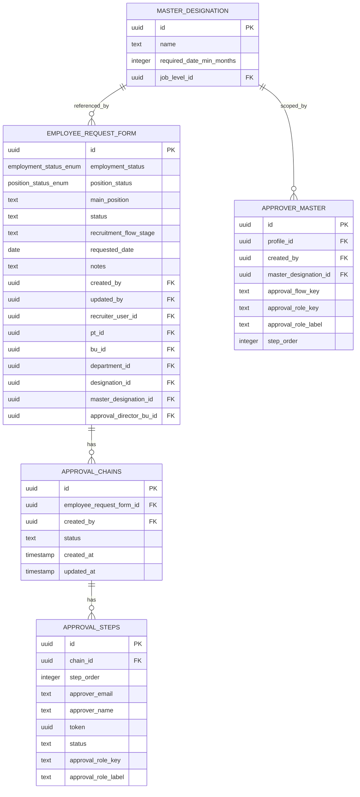
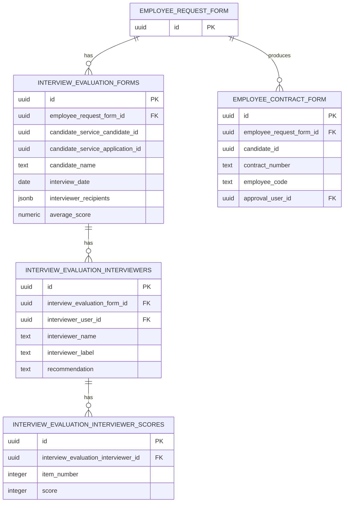
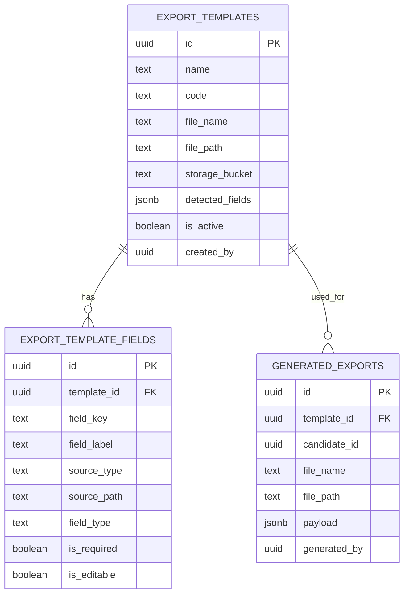
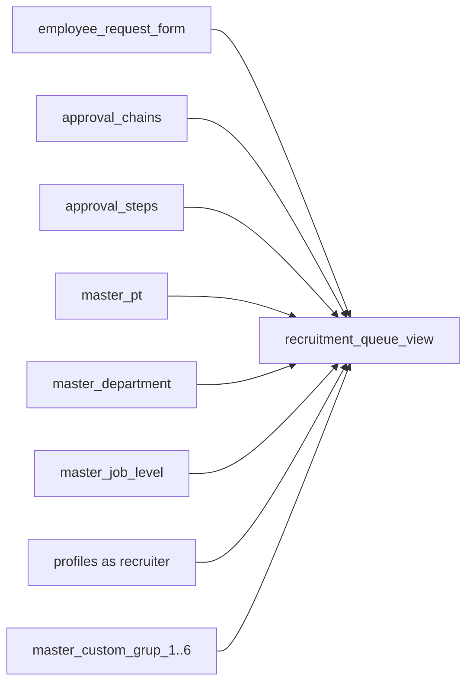

# 06. ERD

## Sumber Analisis

ERD ini disusun berdasarkan `supabase/public-schema.sql`, yaitu dump schema `public` Supabase yang lebih akurat daripada hasil `Copy as SQL` dari dashboard. Karena file ini adalah dump `public` schema, object di schema lain seperti `auth.users` hanya muncul sebagai referensi FK, bukan sebagai definisi tabel penuh.

## ERD Utama

```mermaid
erDiagram
  AUTH_USERS ||--|| PROFILES : referenced_by
  AUTH_USERS ||--o{ USER_ROLES : assigned_to

  ROLES ||--o{ USER_ROLES : assigned
  ROLES ||--o{ ROLE_PERMISSIONS : grants
  PERMISSIONS ||--o{ ROLE_PERMISSIONS : mapped

  MASTER_DEPARTMENT ||--o{ PROFILES : referenced_by
  MASTER_JOB_LEVEL ||--o{ PROFILES : referenced_by

  MASTER_PT ||--o{ EMPLOYEE_REQUEST_FORM : referenced_by
  MASTER_BU ||--o{ EMPLOYEE_REQUEST_FORM : referenced_by
  MASTER_DEPARTMENT ||--o{ EMPLOYEE_REQUEST_FORM : referenced_by
  MASTER_JOB_LEVEL ||--o{ EMPLOYEE_REQUEST_FORM : referenced_by
  MASTER_JOB_LEVEL ||--o{ MASTER_DESIGNATION : mapped_to
  MASTER_DESIGNATION ||--o{ EMPLOYEE_REQUEST_FORM : referenced_by
  MASTER_DESIGNATION ||--o{ APPROVER_MASTER : scoped_by
  PROFILES ||--o{ EMPLOYEE_REQUEST_FORM : approval_director_bu
  MASTER_CUSTOM_GRUP_1 ||--o{ EMPLOYEE_REQUEST_FORM : referenced_by
  MASTER_CUSTOM_GRUP_2 ||--o{ EMPLOYEE_REQUEST_FORM : referenced_by
  MASTER_CUSTOM_GRUP_3 ||--o{ EMPLOYEE_REQUEST_FORM : referenced_by
  MASTER_CUSTOM_GRUP_4 ||--o{ EMPLOYEE_REQUEST_FORM : referenced_by
  MASTER_CUSTOM_GRUP_5 ||--o{ EMPLOYEE_REQUEST_FORM : referenced_by
  MASTER_CUSTOM_GRUP_6 ||--o{ EMPLOYEE_REQUEST_FORM : referenced_by
  PROFILES ||--o{ EMPLOYEE_REQUEST_FORM : created_updated_recruiter

  EMPLOYEE_REQUEST_FORM ||--o{ APPROVAL_CHAINS : has
  PROFILES ||--o{ APPROVAL_CHAINS : created_by
  APPROVAL_CHAINS ||--o{ APPROVAL_STEPS : has

  PROFILES ||--o{ APPROVER_MASTER : profile_or_creator

  EMPLOYEE_REQUEST_FORM ||--o{ INTERVIEW_EVALUATION_FORMS : has
  PROFILES ||--o{ INTERVIEW_EVALUATION_FORMS : created_updated
  INTERVIEW_EVALUATION_FORMS ||--o{ INTERVIEW_EVALUATION_INTERVIEWERS : has
  PROFILES ||--o{ INTERVIEW_EVALUATION_INTERVIEWERS : linked_user_or_audit
  INTERVIEW_EVALUATION_INTERVIEWERS ||--o{ INTERVIEW_EVALUATION_INTERVIEWER_SCORES : has
  PROFILES ||--o{ INTERVIEW_EVALUATION_INTERVIEWER_SCORES : created_updated

  EMPLOYEE_REQUEST_FORM ||--o{ EMPLOYEE_CONTRACT_FORM : produces
  PROFILES ||--o{ EMPLOYEE_CONTRACT_FORM : approval_or_audit

  EXPORT_TEMPLATES ||--o{ EXPORT_TEMPLATE_FIELDS : has
  EXPORT_TEMPLATES ||--o{ GENERATED_EXPORTS : used_for
```

## ERD Modul Approval dan Recruitment

## ERD Modul Interview dan Contract

## ERD Modul Export Configuration

## View Turunan

`recruitment_queue_view` adalah view, bukan tabel fisik. View ini dibentuk dari `employee_request_form`, latest `approval_chains`, ringkasan `approval_steps`, master data, dan profil recruiter.

## Kardinalitas dan Action FK

| Relasi | Kardinalitas | Action FK | Catatan |
| --- | --- | --- | --- |
| `auth.users` -> `profiles` | 1 ke 1 | `ON DELETE CASCADE` | hapus user auth akan menghapus profile |
| `auth.users` -> `user_roles` | 1 ke banyak | `ON DELETE CASCADE` | assignment role ikut terhapus |
| `roles` -> `role_permissions` | 1 ke banyak | `ON DELETE CASCADE` | role mapping ikut terhapus |
| `permissions` -> `role_permissions` | 1 ke banyak | `ON DELETE CASCADE` | permission mapping ikut terhapus |
| `roles` -> `user_roles` | 1 ke banyak | `ON DELETE CASCADE` | role assignment ikut terhapus |
| `employee_request_form` -> `approval_chains` | 1 ke banyak | default | action `ON DELETE` eksplisit tidak terlihat |
| `approval_chains` -> `approval_steps` | 1 ke banyak | `ON DELETE CASCADE` | step ikut terhapus saat chain dihapus |
| `employee_request_form` -> `employee_contract_form` | 1 ke banyak | `ON DELETE RESTRICT` | ERF tidak bisa dihapus jika masih direferensikan kontrak |
| `employee_request_form` -> `interview_evaluation_forms` | 1 ke banyak | `ON DELETE SET NULL` | histori evaluasi tetap hidup |
| `interview_evaluation_forms` -> `interview_evaluation_interviewers` | 1 ke banyak | `ON DELETE CASCADE` | interviewer ikut terhapus |
| `interview_evaluation_interviewers` -> `interview_evaluation_interviewer_scores` | 1 ke banyak | `ON DELETE CASCADE` | score ikut terhapus |
| `export_templates` -> `export_template_fields` | 1 ke banyak | `ON DELETE CASCADE` | mapping field ikut terhapus |
| `export_templates` -> `generated_exports` | 1 ke banyak | `ON DELETE SET NULL` | histori generate tetap tersimpan |
| `profiles` -> beberapa tabel audit | 1 ke banyak | banyak yang `ON DELETE SET NULL` | menjaga histori operasional |

## Relasi yang Hanya Terlihat Sebagai Kolom

| Kolom | Indikasi relasi | Status |
| --- | --- | --- |
| `master_department.bu_id` | dulunya ke `master_bu.id` | FK sengaja di-drop oleh migration `20260514_063`/`20260514_065`; departemen kini independen dari business unit |
| `export_templates.created_by` | kemungkinan ke `profiles.id` | kolom ada, FK tidak ditemukan di dump live |
| `generated_exports.generated_by` | kemungkinan ke `profiles.id` | kolom ada, FK tidak ditemukan di dump live |
| `employee_contract_form.candidate_id` | kandidat eksternal | FK lokal tidak ditemukan |
| `generated_exports.candidate_id` | kandidat eksternal | FK lokal tidak ditemukan |
| `interview_evaluation_forms.candidate_service_candidate_id` | kandidat dari service eksternal | FK lokal tidak ditemukan |
| `interview_evaluation_forms.candidate_service_application_id` | aplikasi kandidat eksternal | FK lokal tidak ditemukan |

## Enum yang Dipakai di Relasi Inti

| Enum | Dipakai oleh |
| --- | --- |
| `employment_status_enum` | `employee_request_form.employment_status` |
| `position_status_enum` | `employee_request_form.position_status` |

Enum lain yang ada di schema tetapi tidak terlihat dipakai pada tabel aktif dump ini:

- `blood_type_enum`
- `education_level_enum`
- `gender_enum`
- `language_proficiency_level`
- `marital_status_enum`

## Catatan Dokumentasi

- `candidate_form` dan child tables kandidat `tidak muncul` pada `supabase/public-schema.sql`. Untuk live schema `public` saat ini, domain kandidat lokal harus dianggap `Belum ditemukan di implementasi database public saat ini`.
- `recruitment_queue_view` aktif di dump live dan perlu dianggap sebagai object database penting untuk halaman recruitment.
- `export_templates`, `export_template_fields`, dan `generated_exports` sudah `ENABLE ROW LEVEL SECURITY`, tetapi dump ini tidak menunjukkan policy eksplisit untuk tiga tabel tersebut.
