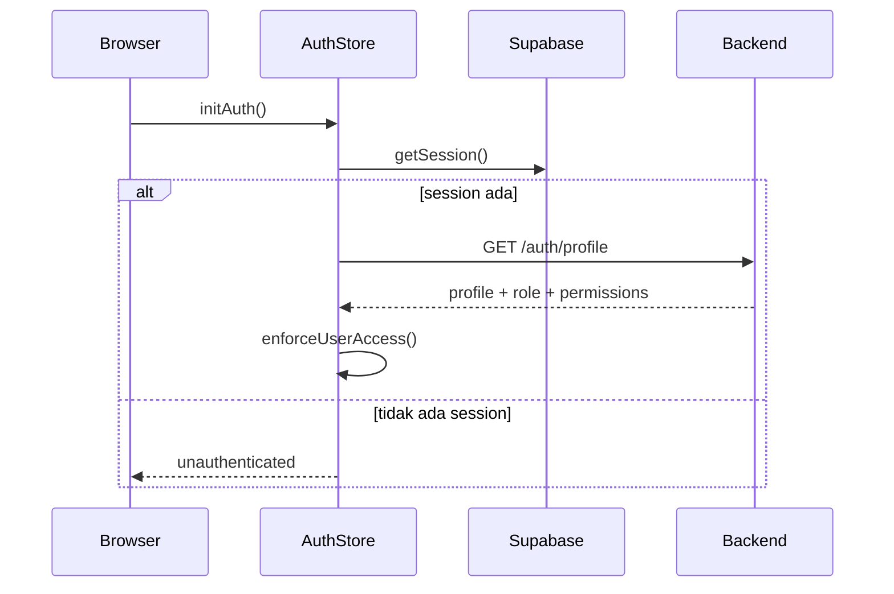

# 07. Auth & Authorization

> Last verified against current repository state: 2026-07-06

## Metode Login

Implementasi login berada di:

- Frontend page: `src/features/auth/LoginPage.vue`
- Auth repository: `src/infrastructure/supabase/repositories/AuthRepositoryImpl.ts`
- Resolve identifier endpoint: `server/routes/auth/resolve-login.post.ts`
- Profile endpoint: `server/routes/auth/profile.get.ts`

Flow login:

1. User mengisi `identifier` dan `password`.
2. Jika `identifier` bukan email, frontend memanggil `POST /auth/resolve-login`.
3. Server mencari email di tabel `profiles` berdasarkan `username`.
4. Frontend melakukan `supabase.auth.signInWithPassword({ email, password })`.
5. Setelah session terbentuk, frontend memanggil `GET /auth/profile`.
6. Server mengembalikan profil, role, dan daftar permission.

## Logout

- Logout dilakukan oleh `authStore.logout()`.
- Implementasi menggunakan `supabase.auth.signOut()`.
- Cache access scope dibersihkan lewat `resetAuthAccessScopeCache()`.

## Session Handling

Session handling ditemukan di:

- `src/stores/authStore.ts`
- `src/plugins/10.auth-init.client.ts`
- `src/infrastructure/http/backendApi.ts`

Perilaku penting:

- Plugin client memanggil `authStore.initAuth()` saat aplikasi start.
- `initAuth()` membaca session dari Supabase.
- Jika session valid, frontend memuat profil backend dari `/auth/profile`.
- Access token Supabase dipakai sebagai bearer token untuk request ke endpoint Nitro internal.
- Untuk role `candidate`, store menghitung masa aktif akses dan dapat melakukan force logout otomatis jika expired (setelah 12 bulan dari aktivasi).

## Middleware Route Protection

Middleware global:

- `src/middleware/access.global.ts`

Aturan utama:

- Route dengan `meta.public = true` tidak membutuhkan login.
- Route lain akan redirect ke `/login?redirect=<path>` bila user belum login.
- Route dapat memakai:
  - `requiredPermissions`
  - `allowedRoles`
  - `allowAdminAccessWithoutPermissions`
- User candidate hanya boleh mengakses route candidate form atau candidate portal.

## Role-Based Access Control

Sumber RBAC:

- `profiles`
- `user_roles`
- `roles`
- `role_permissions`
- `permissions`

Permission katalog aplikasi disimpan di:

- `server/constants/permissions.js`

Role dibaca:

- di client melalui `/auth/profile`
- di server melalui `server/lib/context.js`

## Permission System

Contoh namespace permission yang ditemukan:

| Domain | Permission |
| --- | --- |
| Dashboard | `dashboard:read` |
| ERF | `employee_request_form:create`, `read`, `update`, `delete`, `close`, `assign_recruiter`, `export_pdf`, `requester_read`, `requester_update` |
| Approval | `approval:read`, `approval:action`, `approval:tracking_all` |
| Recruitment | `recruitment:read`, `recruitment:approved_erf_read`, `recruitment:vacancy_pipeline`, `recruitment:vacancy_pipeline_detail`, `recruitment:closed_vacancy`, `recruitment:closed_vacancy_detail`, `recruitment:candidate_database`, `recruitment:document_explorer`, `recruitment:interview_evaluasi` |
| PIC Recruitment | `pic_recruitment:read`, `pic_recruitment:update` |
| Candidate / Employee Form | `candidate_form:*` (termasuk `export_pdf`), `employee_form:*` (termasuk `export_pdf`), `employee_form:update_contract_documents` |
| Interview Evaluation | `interview_evaluation:create`, `read`, `update`, `delete`, `interviewer_form` |
| Employee Contract | `employee_contract_form:create`, `read`, `update`, `delete`, `export_pdf` |
| Export Configuration | `export_configuration:read`, `manage`, `generate` |
| Dokumen | `document:download` |
| User / Role | `user:create`, `user:read`, `user:update`, `user:delete`, `user:switch_to_employee`, `role:manage`, `user_history:read`, `candidate_employee:read` |

Sumber lengkap dan deskripsi tiap permission selalu mengikuti `server/constants/permissions.js` (array `REQUIRED_APP_PERMISSIONS`); tabel di atas hanya ringkasan namespace.

## Access Control Matrix

Berikut matrix akses berdasarkan implementasi route dan service. Ini bukan daftar semua kombinasi role, tetapi daftar permission yang dibutuhkan per modul.

| Modul | Permission minimum |
| --- | --- |
| Login page | public |
| Dashboard | `dashboard:read` |
| Employee Request Form list/detail | `employee_request_form:read` atau `recruitment:approved_erf_read` sesuai route |
| Employee Request Form create | `employee_request_form:create` |
| Employee Request Form edit | `employee_request_form:update` |
| Approval Tracking | `approval:read` |
| Approver Master | `approval:read` + role admin |
| Recruitment Dashboard | `recruitment:read` |
| Vacancy Pipeline | `recruitment:vacancy_pipeline` |
| Closed Vacancy | `recruitment:closed_vacancy` |
| PIC Recruitment | `pic_recruitment:read` (assign recruiter butuh `pic_recruitment:update`) |
| Candidate Database | `recruitment:candidate_database` |
| Document Explorer | `recruitment:document_explorer` |
| Candidate/Employee Forms | `candidate_form:read` atau `employee_form:read` |
| Upload contract documents | `employee_form:update_contract_documents` |
| Interview Evaluation list/manage | `interview_evaluation:read` dan/atau `create` / `update` |
| Interviewer Form | `interview_evaluation:interviewer_form` |
| Employee Contract Form | `employee_contract_form:read/create/update/delete` |
| User Management | `user:read`, `user:create`, `user:update`, `user:delete` |
| Candidate/Employee list | `candidate_employee:read` atau `user:read` |
| Role Management | `role:manage` |
| Export Configuration home | `export_configuration:read` / `manage` / `generate` |
| Export template management | `export_configuration:manage` |
| Export generate | `export_configuration:generate` |

## Halaman yang Membutuhkan Login

Semua halaman selain:

- `/login`
- `/` (langsung redirect berdasarkan role/default route)

## Halaman yang Dibatasi Berdasarkan Role

| Halaman | Pembatasan |
| --- | --- |
| `/approver-master*` | `allowedRoles` hanya admin/administrator/super admin/super_admin |
| `/custom-group-management` | admin only |
| `/master-data-management` | admin only |
| route candidate form | user candidate diprioritaskan ke candidate form/candidate portal |
| `/login` | jika sudah login akan diarahkan ke route default role |

## Contoh Alur Auth dari Kode

## Catatan Penting

- `server/lib/context.js` memeriksa `profiles.is_active`; akun inactive ditolak di server.
- `authStore` juga memaksa logout candidate yang sudah expired (setelah 12 bulan dari aktivasi).
- Admin dapat melewati sebagian permission route bila `allowAdminAccessWithoutPermissions = true`.
- `access.global.ts` memvalidasi query `redirect` lewat `getSafeInternalRedirect()` sebelum dipakai untuk redirect balik ke `/login?redirect=<path>`, untuk mencegah open redirect ke URL eksternal.
- Bila route butuh permission tetapi user tidak punya satupun, middleware mengarahkan ke `/profile` (bukan selalu ke halaman default role).
