# 10. Feature Flow

## 1. Login

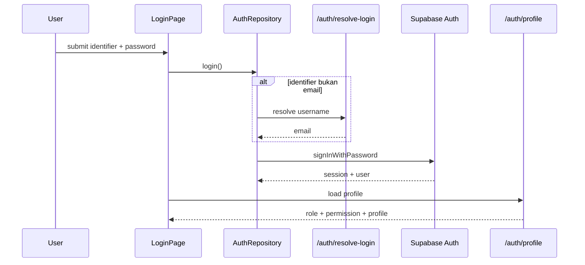

## 2. Manajemen User

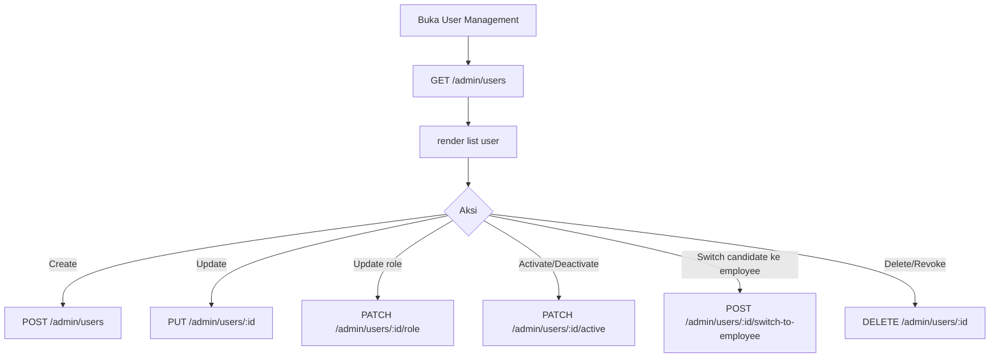

Business rule penting:

- Staff hanya boleh mengelola candidate yang dibuatnya sendiri.
- Candidate account baru wajib di-bind ke ERF eligible.
- Switch ke employee hanya tersedia untuk account `candidate_service` dengan role `candidate`.

## 3. Manajemen Candidate / Employee

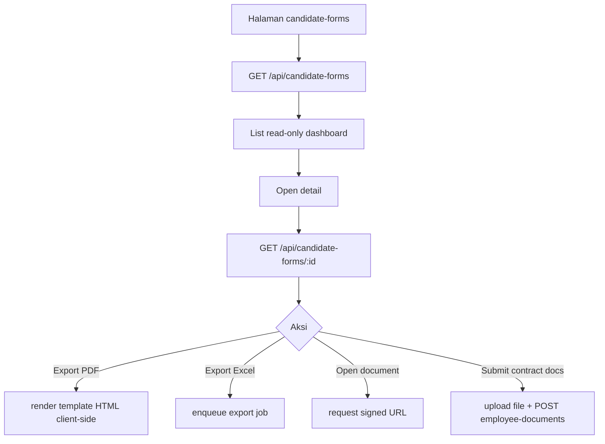

Catatan:

- CRUD utama candidate form tidak aktif di dashboard ini.
- Repository frontend melempar error read-only untuk create/update/delete.

## 4. Import CSV

Status: **Belum ditemukan di implementasi saat ini**.

Temuan analisis:

- Tidak ditemukan page, endpoint, service, parser, atau dependency yang mengimplementasikan import CSV.
- Yang ditemukan justru export Excel (`xlsx`) dan generate DOCX.

## 5. Upload DOCX Template

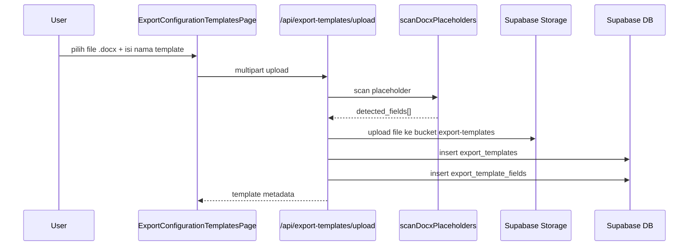

## 6. Deteksi Placeholder DOCX

Teknis implementasi:

1. File DOCX dibuka dengan `PizZip`.
2. XML `word/document.xml`, `header*.xml`, `footer*.xml` dipindai.
3. Placeholder yang terpecah antar XML run dinormalisasi dahulu.
4. Regex `{{\s*([a-zA-Z0-9_.-]+)\s*}}` dipakai untuk mengambil field key.
5. Hasil duplikat dibuang.

## 7. Export Configuration

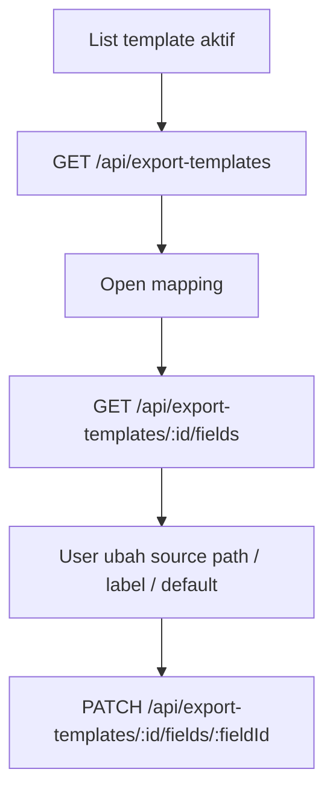

## 8. Mapping Field

Source mapping yang ditemukan:

- direct field key, contoh `candidate_name`
- custom path, contoh `candidate.candidate_name`
- scope kandidat
- scope `employee_request_form`
- scope `employee_contract_form`

Status mapping UI:

- `ready`
- `custom`
- `manual`
- `needs_attention`

## 9. Auto-fill Data Candidate

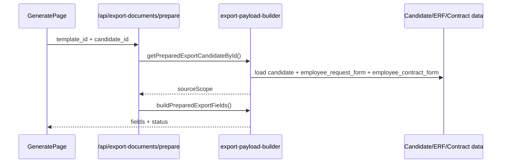

## 10. Manual Override Field

- Setelah `prepare`, user dapat mengubah nilai field editable di halaman generate.
- Field required tetapi kosong akan berstatus `manual_required`.
- Payload final dibentuk dari seluruh field editor sebelum preview/generate.

## 11. Generate Document

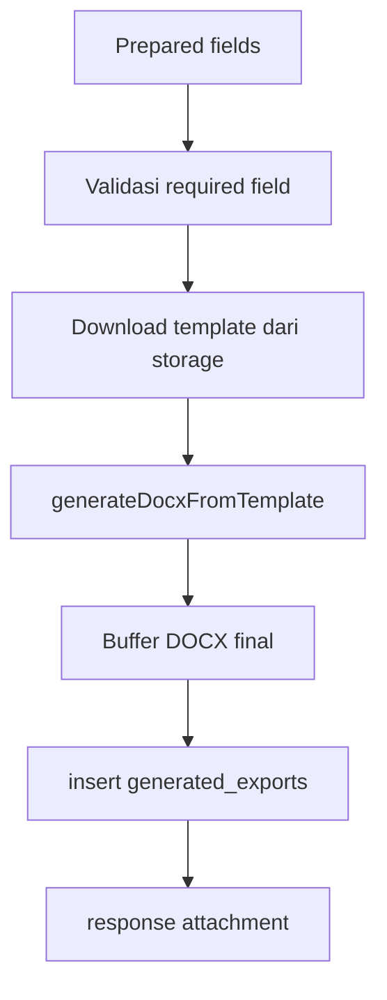

## 12. Download Document

- Endpoint: `POST /api/export-documents/generate`
- Response:
  - `Content-Type: application/vnd.openxmlformats-officedocument.wordprocessingml.document`
  - `Content-Disposition: attachment; filename="<sanitized>.docx"`

## 13. Upload File ke Supabase Storage

### Foto kandidat

- Upload langsung via client Supabase.
- Bucket: `candidatePhotographBucket`
- Path: `candidate-forms/<ownerId>/<filename>`

### Dokumen kontrak employee

- Upload langsung via client Supabase.
- Bucket: `employeeDocumentBucket`
- Path: `employee-forms/<ownerId>/<documentType>/<filename>`
- Setelah upload, path dikirim ke backend agar diteruskan ke candidate service.

### Dokumen ERF (`document_erf`)

- Upload langsung via client Supabase saat create/edit ERF (field `document_erf`, satu file PDF/DOCX).
- Bucket: `getErfDocumentBucket()` (runtime config `erfDocumentBucket`, default `erf`) — bucket yang sama dengan `organizational_structure`/`job_description`.
- Path disimpan sebagai element `text[]` di `employee_request_form.document_erf`.
- File tetap disimpan meski parsing autofill gagal/tidak mengenali field apa pun — hanya proses autofill yang best-effort, bukan upload-nya.
- Muncul di halaman detail ERF (read-only) dan di `RecruitmentDocumentExplorerPage` per kandidat dengan key `erf_document`; akses signed URL divalidasi lewat `assertCandidateFormAssetAccess(..., 'erf_document')`.

### Template export

- Upload via server endpoint.
- Bucket default: `export-templates`
- Path: `templates/<timestamp>-<safe-name>.docx`

## 14. Audit Log

Status audit log eksplisit:

- `generated_exports` menyimpan histori generate dokumen.
- `user_history` tersedia sebagai modul riwayat user, tetapi schema tabel lokal detailnya tidak ditemukan eksplisit di file yang dibaca pada sesi ini.
- Audit log generik lain: **Perlu dikonfirmasi**.

## 15. Employee Request Form, Approval Chain, dan Recruitment Flow Stage

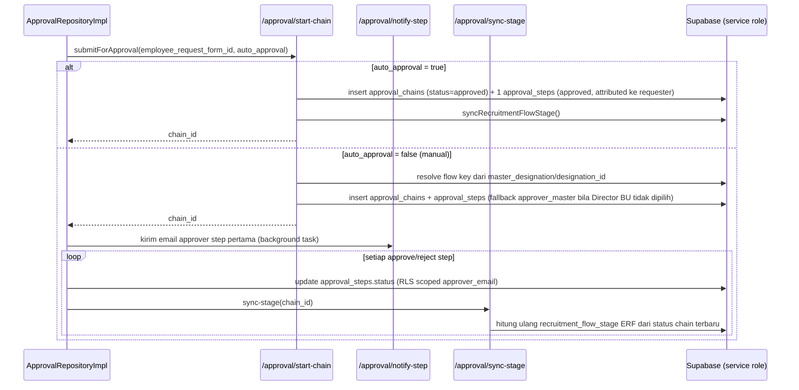

Catatan:

- `/approval/start-chain` berjalan dengan Supabase admin client (service role) khusus untuk insert chain/step agar tidak terhalang RLS `approval_chains`, tetapi tetap memvalidasi pemanggil adalah owner ERF (manager) atau punya permission write ERF.
- Resolusi flow approval (`getApprovalFlowTemplate` + `resolveConfiguredApprovalFlowKeyFromDesignation`) memprioritaskan `master_designation_id` ERF, fallback ke `designation_id` legacy bila designation belum dipetakan.
- `recruitment_flow_stage` pada `employee_request_form` disinkronkan ulang setiap kali ada perubahan status approval lewat `/approval/sync-stage`, bukan dihitung di client.
- Pada form create/edit ERF ada toggle **Manual / Auto Approval** (`approvalMode`). Mode `auto` mengirim `auto_approval: true` ke `start-chain` dan langsung menutup chain dengan satu step approved (`approval_role_key = auto_approval`), tanpa melalui approver step biasa.
- `approval_director_bu_id` tidak lagi wajib diisi sebelum submit ERF (validasi frontend & backend yang mewajibkannya sudah dihapus). Bila kosong, step `director_approval` memakai approver dari `approver_master` yang dikonfigurasi untuk role tersebut, bukan Director BU yang dipilih manual.

## 15b. Upload ERF untuk Autofill Form

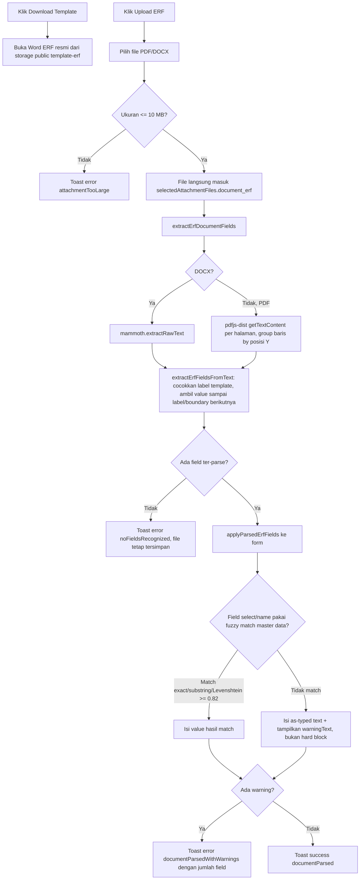

Catatan:

- Parser: `src/presentation/utils/employeeRequestFormDocumentParser.ts` (`extractErfDocumentFields`, `extractErfFieldsFromText`, `parseErfDateValue`, `parseErfProbationMonths`). Fuzzy matcher: `src/presentation/utils/fuzzyMatch.ts` (`findOptionByLabel`, threshold similarity `0.82`).
- Field yang bisa di-autofill: `requested_date`, `required_date`, `pt_pembebanan`, `bu_category`, `department`, `designation`, `main_position`, `employment_status`, `position_status`, `periode_probation`, `direct_manager`, `site`, `working_location`.
- Scanner mengenali label di awal baris (dengan atau tanpa value inline setelah `:`) supaya PDF (label+value satu baris) dan DOCX (label sendiri per baris via mammoth) sama-sama terbaca.
- Watcher pada tiap field form akan menghapus warning mismatch begitu user mengubah value tersebut secara manual.
- Warning mismatch bersifat non-blocking — user tetap bisa submit form dengan value hasil parse yang tidak match, atau mengoreksinya manual.

## 16. PIC Recruitment - Assign Recruiter

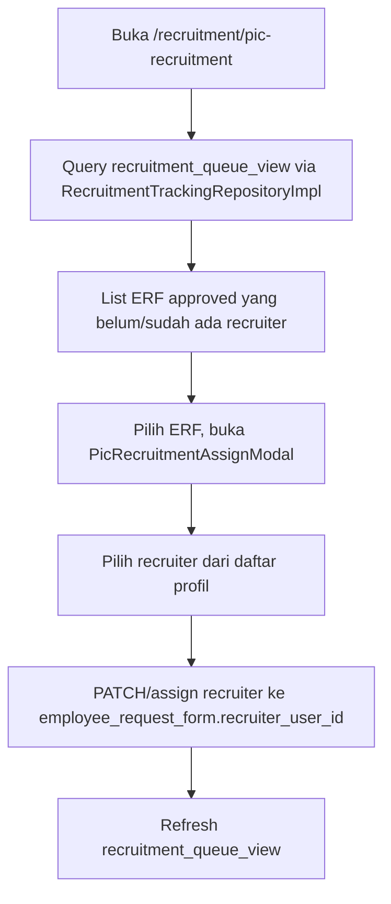

Permission: melihat halaman butuh `pic_recruitment:read` (atau permission terkait ERF approved lainnya); melakukan assignment butuh `pic_recruitment:update`.

## 17. Employee Contract Form (NECF)

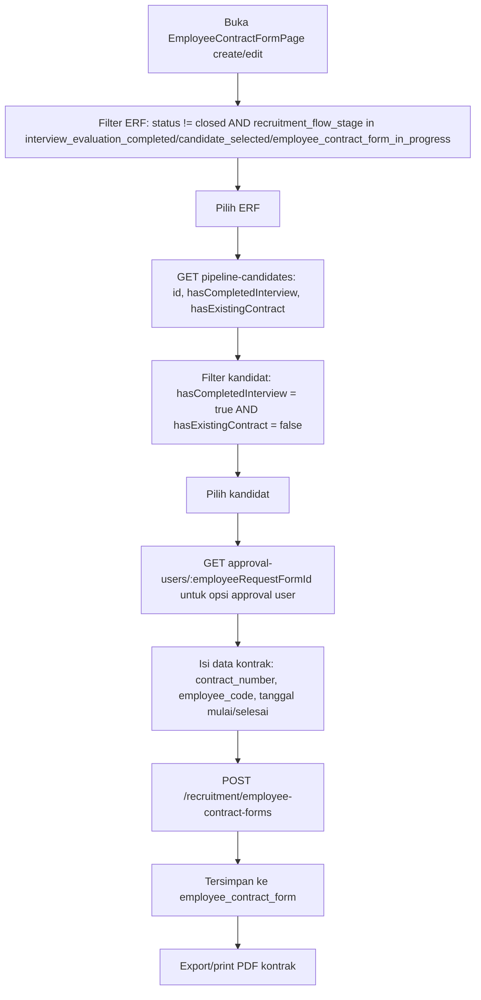

Catatan:

- Satu ERF hanya boleh memiliki satu `employee_contract_form` (`employee_contract_form_candidate_key` unique constraint berbasis kandidat, dan FK ERF bersifat `ON DELETE RESTRICT`).
- Approval user dipilih dari daftar profil yang relevan terhadap ERF terkait, bukan daftar bebas.
- Sejak commit `ad9013b`, daftar ERF yang bisa dipilih di NECF diperluas dari hanya `interview_evaluation_completed` menjadi juga `candidate_selected` dan `employee_contract_form_in_progress` (`necfEligibleRecruitmentFlowStages` di `EmployeeContractFormPage.vue`) — sebelumnya ERF dengan kandidat yang masih lag/belum lolos ke stage berikutnya tidak muncul sama sekali.
- Daftar kandidat per ERF difilter ke kandidat yang `hasCompletedInterview` dan belum `hasExistingContract`. Di mode edit, kandidat yang sedang tersimpan pada form tetap ditampilkan di opsi meski sudah tidak lolos filter eligibility saat ini (agar form edit tidak kehilangan value-nya).
