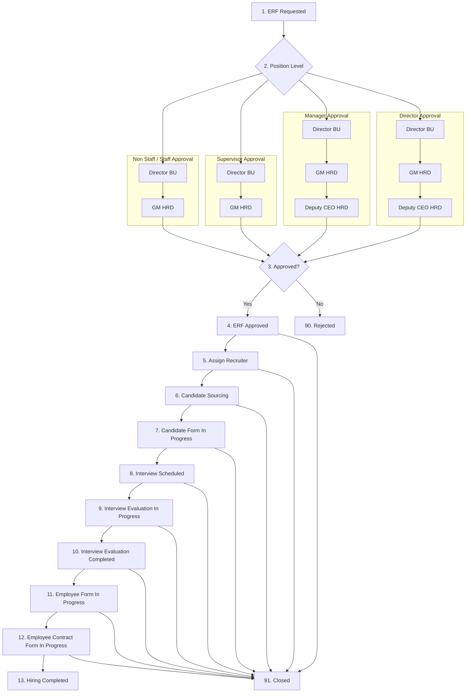

# Recruitment Flow Stage

Dokumen ini menjelaskan urutan stage recruitment, arti setiap stage, dan aturan resolusi status yang dipakai aplikasi.

## Stage List

| Code | Label | Keterangan singkat |
| --- | --- | --- |
| `erf_requested` | `1. ERF Requested` | ERF sudah dibuat, approval chain belum berjalan final. |
| `approval_in_progress` | `2. Approval In Progress` | Approval chain masih punya step pending. |
| `erf_approved` | `4. ERF Approved` | Semua approval selesai, recruiter belum di-assign. |
| `assign_recruiter` | `5. Assign Recruiter` | Semua approval selesai dan recruiter sudah di-assign, tetapi belum ada aktivitas sourcing. |
| `candidate_sourcing` | `6. Candidate Sourcing` | Sudah ada kandidat/account binding atau vacancy sudah masuk sourcing. |
| `assessment_list_created` | `7. Candidate Form In Progress` | Kandidat mulai mengisi candidate form. |
| `interview_scheduled` | `8. Interview Scheduled` | Interview evaluation form sudah dibuat. |
| `interview_evaluation_in_progress` | `9. Interview Evaluation In Progress` | Minimal satu interviewer sudah submit evaluasi, tetapi belum semua selesai. |
| `interview_evaluation_completed` | `10. Interview Evaluation Completed` | Minimal satu kandidat pada ERF sudah selesai dievaluasi (seluruh interviewer pada form kandidat itu complete) — tidak menunggu semua kandidat selesai. |
| `candidate_selected` | `11. Employee Form In Progress` | Kandidat terpilih sudah mulai employee form. |
| `employee_contract_form_in_progress` | `12. Employee Contract Form In Progress` | Employee form completed, dokumen `Draft Employment Contract` (`format_office`) belum lengkap. |
| `hiring_completed` | `13. Hiring Completed` | ERF otomatis closed dengan kategori `employee hired`. |
| `rejected` | `90. Rejected` | Approval ditolak di salah satu step. |
| `closed` | `91. Closed` | ERF closed non-hiring, misalnya canceled. |

## Mermaid Flow

## Approval Phase

### `erf_requested`

ERF sudah dibuat. Approval chain bisa masih draft atau belum dimulai.

### `approval_in_progress`

Approval chain sudah berjalan dan masih ada step pending.

Catatan:
- Jumlah approver tidak lagi diasumsikan selalu 3 step.
- UI approval progress mengikuti `approval_steps` dynamic.
- Jika progress menunjukkan `2/2 Approved` atau `3/3 Approved`, ERF tidak boleh lagi dibaca sebagai `Approval In Progress`.

### `rejected`

Jika chain atau salah satu step berstatus `rejected`, stage langsung `rejected`.

## Post Approval Phase

### `erf_approved`

Semua approval selesai, tetapi recruiter belum di-assign.

### `assign_recruiter`

Semua approval selesai dan recruiter sudah di-assign, tetapi belum ada aktivitas recruitment lanjutan.

Implementasi saat ini:
- assign dilakukan dari menu `PIC Recruitment`
- menu `PIC Recruitment` berada di bawah menu `Employee Request Form (ERF)`
- list pada `PIC Recruitment` hanya menampilkan ERF open dengan stage `erf_approved` atau `assign_recruiter`
- jika ERF sudah masuk `candidate_sourcing` atau stage setelahnya, ERF tidak tampil lagi di menu ini

## Recruitment Phase

### `candidate_sourcing`

Menandakan recruitment sudah mulai berjalan di sisi sourcing.

Contoh sinyal:
- `vacancy_status = sourcing`
- sudah ada kandidat yang terikat ke ERF tetapi belum mulai candidate form

### `assessment_list_created`

Kandidat mulai mengisi candidate form.

### `interview_scheduled`

Interview evaluation form sudah dibuat pada Assessment List.

### `interview_evaluation_in_progress`

Sebagian interviewer sudah submit evaluasi, tetapi belum semua selesai.

### `interview_evaluation_completed`

Minimal satu kandidat pada ERF sudah punya evaluation form yang seluruh interviewer-nya complete (`hasFullyCompletedCandidateInterview` di `recruitmentFlowStageService.js`).

Catatan:
- sejak commit `ad9013b`, resolusi stage ini berubah dari "**semua** kandidat/form pada ERF harus selesai" (`allInterviewersCompleted`, cek `forms.every(...)`) menjadi "**minimal satu** kandidat sudah selesai" (`forms.some(...)`) — sebelumnya, jika ada satu kandidat yang masih lag, ERF tidak pernah masuk stage ini sama sekali walau kandidat lain sudah lengkap
- endpoint `GET /api/employee-request-forms/:id/pipeline-candidates` mengekspos flag per kandidat `hasCompletedInterview` dan `hasExistingContract` supaya NECF bisa memfilter kandidat mana yang sudah siap dibuatkan kontrak, terlepas dari kandidat lain yang masih lag

### `candidate_selected`

Kandidat terpilih dengan role employee mulai mengisi employee form.

### `employee_contract_form_in_progress`

Employee form sudah complete, tetapi dokumen `Draft Employment Contract` (`format_office`) belum lengkap.

Catatan:
- sejak commit `3ff1b4c`/`d1873c8`/`28aa802`, `SKB` tidak lagi wajib untuk resolve stage ini — hanya `format_office` yang menentukan kelengkapan
- input `Lainnya` adalah dokumen tambahan opsional
- `Lainnya` bisa multiple PDF

### `hiring_completed`

Jika employee form completed dan dokumen `Draft Employment Contract` (`format_office`) lengkap, ERF otomatis di-close dengan:
- `closed_category = employee hired`
- `reason = hired`

## Closed Phase

### `closed`

ERF ditutup tanpa hiring.

Contoh:
- kebutuhan dibatalkan
- tidak ada kandidat sesuai
- perubahan budget atau strategi

## Status Resolution Priority

Resolver status di aplikasi mengikuti prioritas ini:

1. `rejected` selalu menang paling atas.
2. Jika ERF `closed`:
   - `employee hired` => `hiring_completed`
   - selain itu => `closed`
3. Jika ada persisted downstream stage yang stabil:
   - `assessment_list_created`
   - `interview_scheduled`
   - `interview_evaluation_in_progress`
   - `interview_evaluation_completed`
   - `candidate_selected`
   - `employee_contract_form_in_progress`
   - `hiring_completed`
4. Jika `vacancy_status` sudah menunjukkan aktivitas recruitment:
   - `sourcing` => `candidate_sourcing`
   - `interview` => `interview_evaluation_in_progress`
   - `accepted` => `interview_evaluation_completed`
5. Jika approval dynamic belum penuh approved => `approval_in_progress`
6. Jika approval dynamic sudah penuh approved:
   - ada recruiter => `assign_recruiter`
   - belum ada recruiter => `erf_approved`
7. Fallback legacy hanya dipakai jika `approval_steps` dynamic tidak tersedia.

## UI Notes

### Tabel ERF

Kolom `Position Status` pada menu Employee Request Form (ERF) ditampilkan sebagai badge:

- `Replacement`: orange
- `New Position MPP`: blue
- `New Position Non-MPP`: cyan
- `Internship`: green
- kosong atau nilai tidak dikenal: gray

Badge ini hanya representasi UI.

### PIC Recruitment

Kolom utama:
- No
- Department
- Business Unit Category
- Main Position
- Recruiter
- Position Status
- Employment Status
- Status

Filter:
- search text
- position status
- employment status
- stage status
- ERF without recruiter

## Summary

- Approval chain bersifat dynamic, bukan fixed 3 step.
- Stage baru setelah `ERF Approved` adalah `Assign Recruiter`.
- Assign recruiter tidak lagi dilakukan dari action pada list ERF, tetapi dari menu `PIC Recruitment`.
- Stage downstream seperti sourcing/interview harus menang atas fallback approval legacy.
